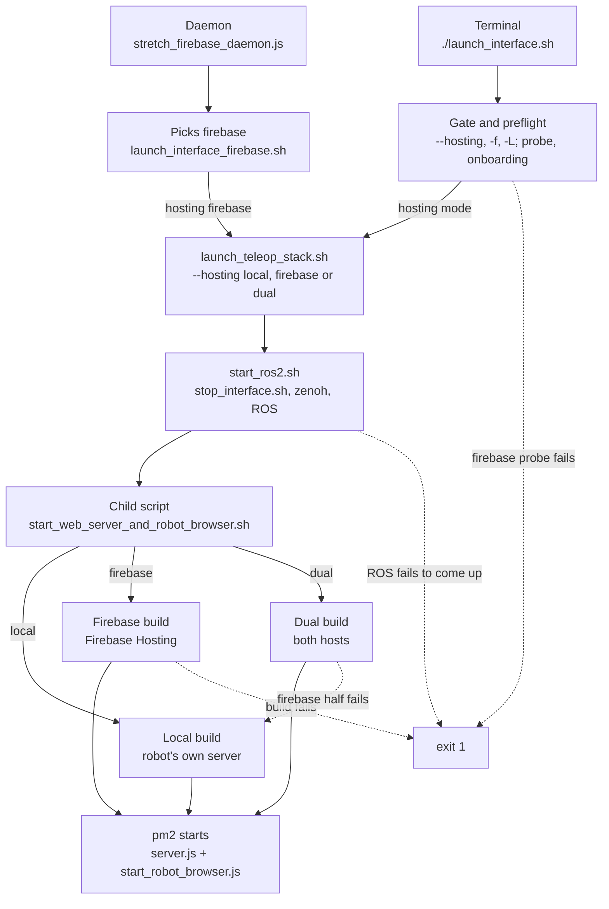

# Launching the Interface

A launch brings up three things in order: the `ROS2` drivers, a local HTTPS server, and a headless robot browser that joins a signaling room and waits for an operator. Two entry points start that sequence — a person at a terminal, and the onboard Firebase daemon acting on a request from a dashboard. Both run the same code to do it.

What differs between them is the **hosting mode**: which host serves the operator interface.

## Hosting modes

The robot's own `express` server runs in every mode. The hosting mode decides where an operator *fetches* the interface from, and with it which signaling transport the robot browser joins.

| Mode | Operator interface served by | Bundles built | Reachable from |
| --- | --- | --- | --- |
| `local` | the robot's `express` server | `dist/` | Tailscale, WiFi, localhost |
| `firebase` | Firebase Hosting | `dist-firebase/` | your Firebase site |
| `dual` | both hosts at once | `dist/` and `dist-firebase/` | both |

In `local` mode the robot browser uses `LocalSignaling` over `socket.io`. In `firebase` mode it uses `FirebaseSignaling` against the Realtime Database. In `dual` mode it runs `TeleopSignalingCoordinator`, which joins both and lets whichever operator arrives first hold the session.

The Firebase modes are optional and self-hosted: they work only if you have set up a Firebase project under your own account and deployed a dashboard into it, which is what [`onboard_firebase_robot.sh`](pages/operator/tsx/storage_handler/README.md) does. Nothing here is operated by Hello Robot.

## Launch intents

Choosing hosts is only half of what a launch decides. The other half is what counts as a failure worth printing — and those are different questions. A plain `./launch_interface.sh` and `--hosting dual` ask for the same two hosts, but they should not complain in the same way.

`launch_interface.sh` resolves its flags into one of four intents.

| Intent | Set by | Attempts | Fatal when | Reports |
| --- | --- | --- | --- | --- |
| `ARG_DEFAULT` | no hosting flag | local and firebase | neither is available | a Firebase that was set up and broke — never one that was never set up |
| `ARG_DUAL` | `--hosting dual` | local and firebase | neither is available | whichever half failed |
| `ARG_LOCAL` | `-L`, `--hosting local` | local | local fails | local's failure |
| `ARG_FIREBASE` | `-f`, `--hosting firebase` | firebase | firebase fails | firebase's failure |

`ARG_DEFAULT` and `ARG_DUAL` request identical hosts and die under identical conditions. They differ only in what they say on the way, and that difference is the whole point: naming a mode asserts that you want it, so a half that does not come up is news. Naming nothing asserts nothing.

The silence has a specific target. Most robots will never touch Firebase, and an operator who has never set it up should not be told that something they never enabled is broken. So `ARG_DEFAULT` separates two outcomes a boolean could not hold apart: no Firebase credentials in `.env` at all means nobody ever started, and it passes without comment; credentials present with anything failing means somebody did start and it has since stopped working, which earns a warning even on a launch that never asked for it.

> _**NOTE:**_ Hosting mode is a different axis from Hosting *deploys*. `WEB_TELEOP_AUTODEPLOY=0` stops preview-channel uploads while Firebase Hosting carries on serving the build it already has. A robot can be in `firebase` hosting mode with deploys switched off.

## Two ways to launch

**From a terminal**, `./launch_interface.sh` is the front door. It resolves the hosting mode, runs the Firebase preflight when a cloud mode was asked for, validates the installation, and at the end prints the URLs an operator should visit. It is the only script that decides anything.

**From your dashboard**, `stretch_firebase_daemon.js` receives a command over the Realtime Database and runs `launch_interface_firebase.sh`. That script picks `firebase` and hands off; it has no gate of its own, because a daemon that is already signed in has proven what the preflight would ask. It never builds the local bundle, since a robot reachable only over Tailscale is no use to a dashboard.

Everything after that point is shared.

## The shared spine

`launch_teleop_stack.sh` is the spine both front doors call. It sets up the robot environment, runs `start_ros2.sh`, then runs `start_web_server_and_robot_browser.sh` with the chosen mode. ROS comes up exactly one way regardless of who asked.

`start_ros2.sh` is a gate, not merely a step. It tears down any previous stack through `stop_interface.sh`, verifies `rmw_zenohd` actually started, and scans the launch log for errors. Any of those failing stops the launch before bundles are built, so a dead `ROS2` stack can never be reported as a successful launch.

`start_web_server_and_robot_browser.sh` builds the bundles the mode calls for, waits for them with `waitForBundles.js`, then starts `server.js` and `start_robot_browser.js` under `pm2`. It writes the mode it actually started to `<logdir>/hosting_mode`, which the front door reads back so it never advertises a host the launch did not bring up.

## When a host is unavailable

Four checks run before the stack starts, and they fail differently on purpose.

The **local preflight** checks the certificates the robot's own HTTPS server needs, which are named after `HELLO_FLEET_ID`. It gates the local host alone — a robot with broken certificates can still serve through Firebase Hosting — so it stops `-L` without stopping `-f`.

The **signaling preflight** (`scripts/checkFirebaseRobotAccess.js`) signs in with the robot account and reads `assignments/<uid>` — exactly what the robot page does moments later. It is the only check that can veto a cloud host, and its exit code says which of two very different things went wrong:

| Exit | Meaning |
| --- | --- |
| `0` | Firebase signaling can work on this robot right now. |
| `2` | No Firebase credentials in `.env`; nobody has ever set this robot up for Firebase. |
| `3` | Credentials are present and something is wrong — the install, the account, the binding, or the network. |

It parses `.env` itself instead of through `dotenv`, and requires the Firebase packages only after the credential check passes, so a robot that never touched Firebase exits `2` at once rather than dying on a missing module.

The **hosting preflight** checks the Firebase CLI credential, which is separate from the robot account and only uploads builds. Failing it sets `WEB_TELEOP_AUTODEPLOY=0` and the launch proceeds.

The **daemon check** warns when `stretch-web-teleop-daemon.service` is down, because your dashboard cannot start or stop a robot without it. It never vetoes.

What happens next is the intent's decision, not the preflight's. `ARG_FIREBASE` exits non-zero, because it has no second host to fall back to — and a non-zero exit is how the daemon learns to report the launch as failed rather than claiming success over a robot your dashboard cannot reach. Every other intent keeps whichever host works, and they differ only in whether they say so.

The same rule applies later, if the build itself fails rather than the preflight.

## Reference: script arguments

| Script | Flag | Argument | Meaning |
| --- | --- | --- | --- |
| `launch_interface.sh` | `--hosting` | `local`, `firebase` or `dual` | Hosting mode, asserted. With no flag the intent is `ARG_DEFAULT`. |
| | `-f` | — | Firebase only. Shorthand for `--hosting firebase`. |
| | `-L` | — | Local only. Wins over every other source. |
| | `-m` | path to `.yaml` | Map to load. Ignored if the file does not exist. |
| | `-h`, `--help` | — | Show usage. |
| `launch_interface_firebase.sh` | `-m` | path to `.yaml` | Map, passed through. Mode is fixed at `firebase`. |
| `launch_teleop_stack.sh` | `--hosting` | `local`, `firebase` or `dual` | Hosting mode. Defaults to `dual`; rejected if not one of the three. |
| | `-m` | path to `.yaml` | Map, passed to `start_ros2.sh`. |
| | `-l` | directory | Log directory. Defaults to `WEB_TELEOP_LOG_DIR`, then a fresh timestamped one. |
| `start_ros2.sh` | `-l` | directory | Log directory. Ignored if not an existing directory. |
| | `-m` | path to `.yaml` | Map; becomes `map_yaml:=` on the ROS launch. |
| `start_web_server_and_robot_browser.sh` | `--hosting` | `local`, `firebase` or `dual` | Hosting mode, and so which bundles to build. Defaults to `dual`. |
| | `-f` | — | Firebase only. Shorthand for `--hosting firebase`. |
| | `-l` | directory | Log directory, also exported as `REDIRECT_LOGDIR` for `pm2` children. |
| | `-o` | file path | Log file, so parent and child write to the same one. |
| `stop_interface.sh` | — | — | No arguments. |
| `firebase_console_config.sh` | `--install` | — | Create and start the daemon service. |
| | `--refresh` | — | Restart background processes; resets status to standby. |
| | `--deploy` | — | Build production assets and deploy to Firebase. |
| `onboard_firebase_robot.sh` | `--email` | address | Operator to assign this robot to. Prompted for when omitted. |
| | `--non-interactive` | — | Never prompt. Needs `--email` and a logged-in Firebase CLI. |
| | `--skip-daemon` | — | Do the Firebase work only, installing no service. |
| | `-h`, `--help` | — | Show usage. |

## Reference: environment variables

| Variable | Values | Meaning |
| --- | --- | --- |
| `WEB_TELEOP_HOSTING` | `local`, `firebase` or `dual` | Standing hosting mode, from the environment or `.env`, asserted like a flag. Any other value is an error. Beaten by `-f`, `--hosting` and `-L`. |
| `WEB_TELEOP_BUILD_MODE` | `development` or `production` | Watch-and-rebuild, or a one-shot production build. |
| `WEB_TELEOP_LOG_DIR` | directory | Log directory. The daemon sets it so it can tail the whole run. |
| `WEB_TELEOP_AUTODEPLOY` | `0` or `1` | Set to `0` when the Firebase CLI has no usable credential. Skips preview uploads; does not change the hosting mode. |
| `WEB_TELEOP_FIREBASE_PROBE_TIMEOUT_MS` | milliseconds, default `15000` | Deadline on the signaling preflight. |
| `WEB_TELEOP_LEASE_TIMEOUT_MS` | milliseconds, default `8000` | Deadline on each teleop-lease call. |
| `WEB_TELEOP_BUILD_TIMEOUT_MS` | milliseconds, default `120000` | How long `waitForBundles.js` waits for bundles. |
| `FIREBASE_TOKEN` | CI token | Lets the hosting preflight pass with no interactive CLI login. |

Intent precedence runs lowest to highest; the last one that applies wins. Default, then `WEB_TELEOP_HOSTING`, then `-f`, then `--hosting`, then `-L`.
Every launch script rejects an unknown flag and takes `-h`/`--help`.

## Shared libraries

These are sourced rather than executed, because the environment they set has to land in the calling shell.

| Library | Provides | Sourced by |
| --- | --- | --- |
| `scripts/lib/teleop_env.sh` | `teleop_setup_env`: `PATH`, `hello-robot.conf`, fleet identity, middleware, workspace overlay | `launch_interface.sh`, `launch_teleop_stack.sh`, `start_ros2.sh` |
| `scripts/lib/teleop_config.sh` | `.env` reading, build-mode resolution, log directory and the `latest_run` symlink | `launch_interface_firebase.sh`, `launch_teleop_stack.sh` |
| `scripts/lib/hosting_gate.sh` | `hosting_mode_setting`, the local and Firebase preflights, the daemon warning | `launch_interface.sh` |
