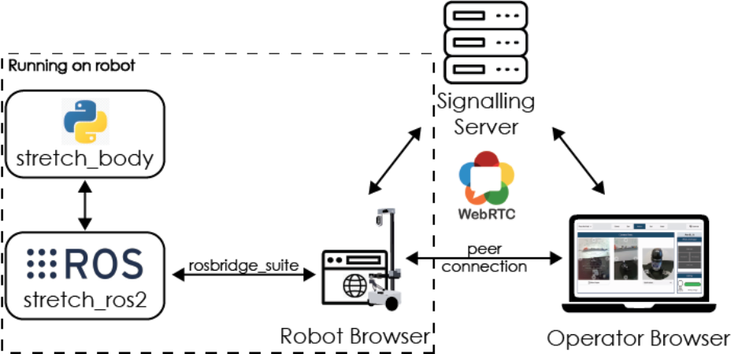
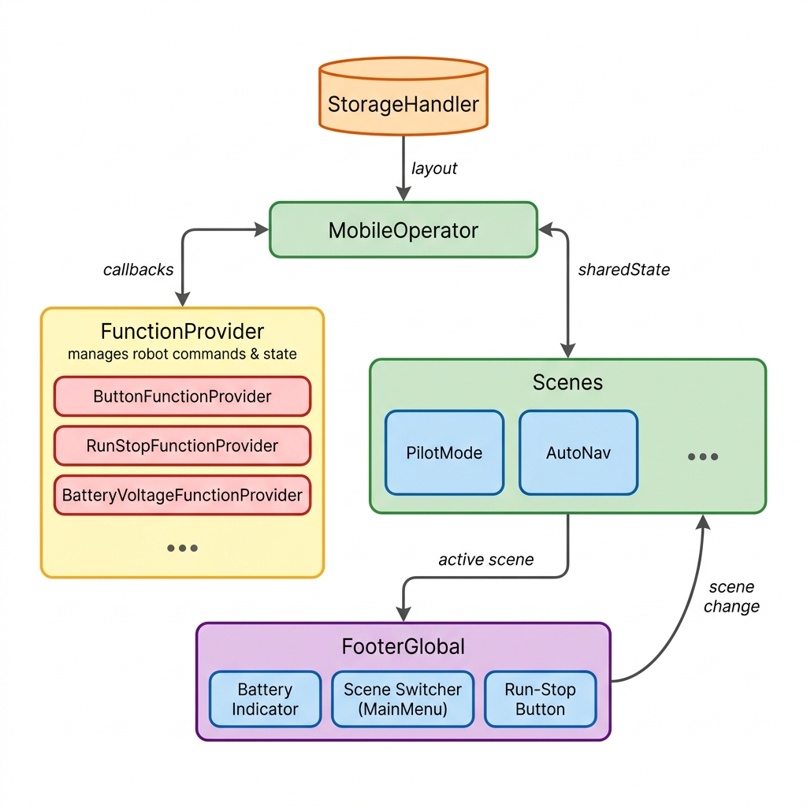

# Software Architecture

Stretch Web Teleop uses `ROS2`, `WebRTC` (web real-time communication), `Python`, `NodeJS`, and `TypeScript`. Webpack compiles two browser entrypoints (`src/pages/`): the **operator** teleoperation UI and the optional **home** fleet lobby. Onboard the robot, the **robot peer** (`start_robot_peer.py`, see [`primer_robot.md`](primer_robot.md)) is a ROS 2 node and a WebRTC peer in one Python process. The operator browser sends commands and receives sensor/video streams through a WebRTC peer connection to the robot peer, which talks to `ROS2` directly with `rclpy`: it turns the `JSON` messages on the data channel into `ROS2` topics, services, and actions and vice versa, and streams the cameras as WebRTC video.

When the interface is launched on the robot (see [`primer_launch.md`](primer_launch.md)), the `ROS2` drivers, the local `express` HTTPS server, and the robot peer start in sequence. Depending on `HOSTING_MODE`, WebRTC signaling runs over one or both transports (operator side in `src/shared/signaling/`, robot side in `stretch4_web_teleop_robot/signaling/`):

- **`local` mode (default)**: The robot peer joins a local `socket.io` room (`LocalSignaling`), and the robot's server serves the interface over LAN at `https://<robot-ip>/local/operator/` (or remotely through a tunnel such as `ngrok`; see [`README.md`](../README.md#using-the-interface-remotely)).
- **`firebase` mode (optional, self-hosted)**: The robot peer's `TeleopSignalingCoordinator` joins both the local `socket.io` room and a Firebase Realtime Database signaling room (`rooms/<robotUid>`) simultaneously, so operators can connect either over LAN or over the internet from a self-hosted Firebase project (`https://<project-id>.web.app/`).

Because WebRTC data-channel commands and telemetry (`src/shared/commands.tsx`, `src/shared/remoterobot.tsx`) are version-coupled between the operator bundle and the robot peer, a Firebase Hosting deployment serves one shared fleet lobby (`/`) alongside multiple immutable, versioned operator **rails** (`/r/<tag>/operator/`). Each robot's onboard daemon (`scripts/stretch_firebase_daemon.js`) publishes its git tag to `robots/<fleetId>/build`, and the lobby routes each robot card to its matching `/r/<tag>/operator/?robot=<fleetId>` bundle (see [`primer_rails.md`](primer_rails.md)).

> _**NOTE:**_ Only one operator peer connection to the robot peer can be active at a time across both signaling transports. Additional connection attempts are rejected until the active session disconnects.

Once a peer connection is established, the interface renders the default layout (see [render logic flow](primer_software_architecture.md#render-logic-flow)) on the operator browser and the user can control the robot.

For example, assume the user clicks a button to drive the robot forward: the command is sent to the robot peer over the data channel, and the robot peer publishes it as a `ROS2` message. The robot peer also sends information, such as joint limits and collision information, to the operator browser. When the user closes the browser, the peer connection is disconnected and another user can connect to the interface.

## Render Logic Flow

The `StorageHandler` (`LocalStorageHandler` backed by browser `localStorage`, or `FirebaseStorageHandler` backed by Realtime Database `operators/<identity>`) persists and retrieves the operator's `layout` — including action mode, speed, and pilot controls — and passes it to `MobileOperator` on startup. `MobileOperator` is the root React component and manages all top-level state (button collisions, camera selection, velocity scale, active scene, etc.). It initializes a set of **Function Providers** (e.g. `ButtonFunctionProvider`, `RunStopFunctionProvider`, `BatteryStateFunctionProvider`) that abstract the communication layer between UI components and the remote robot, exposing functions and firing callbacks back into `MobileOperator` when robot state changes.

`MobileOperator` renders a **Scenes** container that holds the currently active scene alongside `FooterGlobal`. Each scene (currently `PilotMode` and `AutoNav`) is a self-contained view: `PilotMode` hosts the overhead camera, drive controls, movement recorder, and gripper picture-in-picture, while `AutoNav` hosts the occupancy-grid map and autonomous navigation controls. `FooterGlobal` is always visible and provides the **Scene Switcher** (via `MainMenu`) to transition between scenes, a **Battery Indicator**, and the **Run-Stop** button.
